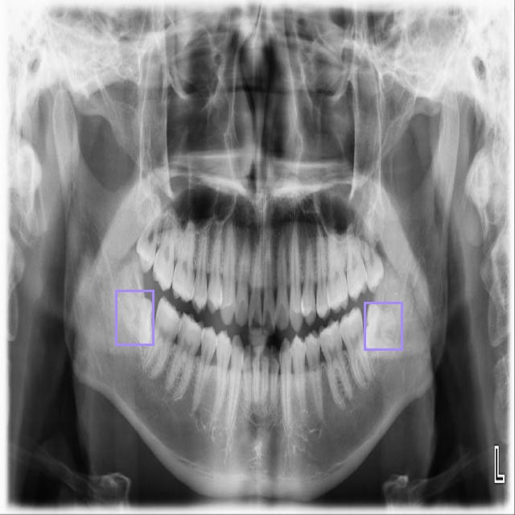
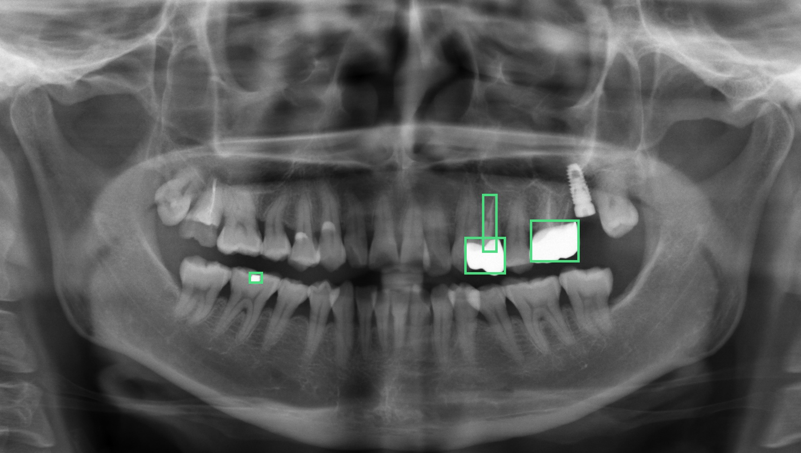
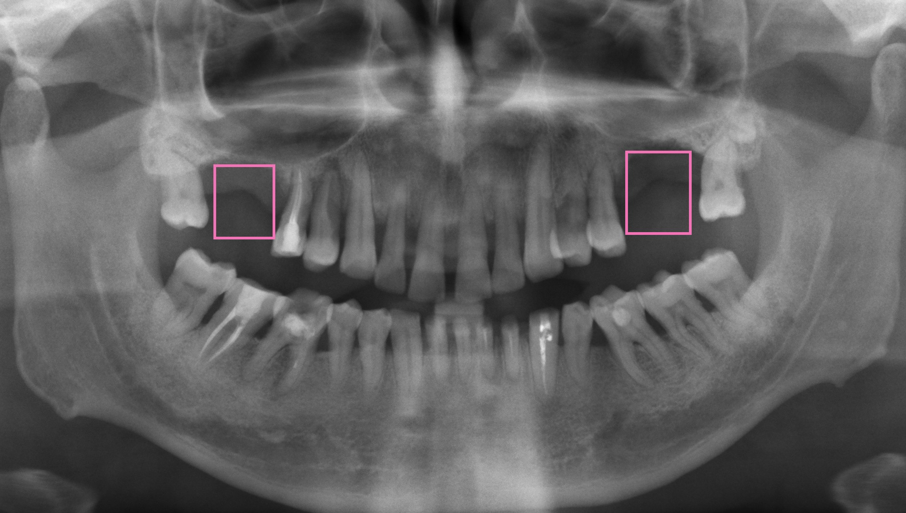

# DentaAI — Panoramik Röntgen Bölümü

**Sunum tarihi:** 25 Ekim 2026  
**Ölçümlerin tamamlandığı tarih:** 21 Ekim 2026  
**Kapsam:** Hekime açık olan dört tanı grubu

Panoramik filmde bugün hekime gösterilen dört tanı, ayrı modellerle ölçüldü. Bir sonuç, doğrulama kümesinde **mAP50 değeri %90’ın üzerindeyse** raporda yer alır. Panoramik işaretler **16 yaş ve üzeri** filmlerde gösterilir.

mAP50, tahmin kutusunun gerçek bölgeyle en az yarı yarıya örtüştüğü tespitlerin özet başarısıdır. Precision, işaretlerin ne kadarının doğru çıktığını gösterir. Recall, filmdeki gerçek bulguların ne kadarının bulunduğunu gösterir. mAP50–95, kutunun kenarlarının ne kadar sıkı oturduğunu da hesaba katar. Rapordaki kabul ölçütü mAP50’dir.

Gömülü diş ToothTruth kümesinden gelir. İmplant, restorasyon ve eksik diş OralXrays-9 kümesinden gelir. Her grup kendi doğrulama kümesinde ayrı ölçülmüştür. Modeller YOLO11n mimarisiyle, 640 piksel çözünürlükte eğitildi.

---

## Bugün ekranda olan dört tanı

| Tanı | Kaynak | Sınıf sayısı | mAP50 | Precision | Recall | mAP50–95 | Güven tabanı |
|---|---|---:|---:|---:|---:|---:|---:|
| Gömülü diş | ToothTruth | 1 | **%95,5** | — | — | — | 0,40 |
| İmplant | OralXrays-9 | 1 | **%99,0** | %98,6 | %99,0 | %82,6 | 0,50 |
| Dolgu, kuron, köprü, kanal | OralXrays-9 | 4 | **%94,4** | %90,9 | %92,2 | %75,6 | 0,50 |
| Eksik diş | OralXrays-9 | 1 | **%97,0** | %91,7 | %93,0 | %61,0 | 0,50 |

İşaret, modelin güveni bu tabanın üzerindeyse filme çizilir. Gömülü diş arayüzde %96 olarak yuvarlanır. Gömülü diş için ayrıntılı Precision ve Recall bu sette saklı değildir; üründeki ölçüm mAP50’dir.

Kesik çizgi, ürün eşiği olan %90’dır. Dört grup da eşiğin üzerindedir.

---

## Gömülü diş

ToothTruth panoramik kümesinden alınan sınıf gömülü diştir. Doğrulama mAP50 değeri **%95,5**’tir.

Doğrulama filminde model iki gömülü diş işaretledi. Aşağıdaki karede 2 tespit vardır.

---

## İmplant

OralXrays-9 kümesinde **1.087 eğitim** ve **970 doğrulama** görüntüsü vardır. Eğitim, doğrulama skoru sabitlenince 76. epoch’ta durdu. En iyi mAP50–95 61. epoch’tadır.

| Ölçü | Son ölçüm | En yüksek |
|---|---:|---:|
| Precision | %98,6 | %99,1 |
| Recall | %99,0 | %99,5 |
| mAP50 | **%99,0** | **%99,2** |
| mAP50–95 | **%82,6** | **%82,8** |

Çok implantlı bir doğrulama filminde arayüz implant kutularını çizdi. Aşağıdaki karede 21 tespit vardır.

---

## Restorasyonlar

Dört sınıf birlikte okunur: **köprü, kuron, dolgu ve kanal tedavisi**. Eğitimde 6.322 görüntü, doğrulamada 1.887 görüntü ve 7.701 örnek vardır. En iyi ağırlık 57. epoch’tadır.

| Ölçü | Değer |
|---|---:|
| Precision | **%90,9** |
| Recall | **%92,2** |
| mAP50 | **%94,4** |
| mAP50–95 | **%75,6** |

Birinci epoch’ta mAP50 %88 idi. Dördüncü epoch’ta %90’ı geçti ve 57. epoch’ta %94,4’te kaldı. Eğitim etiketleri: köprü 4.320, kuron 3.800, dolgu 9.427, kanal 6.094. Dolgu en sık sınıftır. Köprü ile kuron radyografide birbirine daha yakındır. Dört sınıfın birlikte %94,4 vermesi bu yüzden implantın tek sınıf skorundan düşüktür; eşik yine geçilmiştir.

Doğrulama filminde model 4 restorasyon işaretledi: 2 kuron, 1 kanal tedavisi ve 1 dolgu. Aşağıdaki karede 4 tespit vardır.

---

## Eksik diş

OralXrays-9 kümesinde **2.164 eğitim** ve **466 doğrulama** görüntüsü vardır. Doğrulamada 660 örnek işaretlidir. Eğitim bu bilgisayarda 8,1 saat sürdü. En iyi sonuç 27. epoch’ta oluştu.

| Ölçü | Değer |
|---|---:|
| Precision | **%91,7** |
| Recall | **%93,0** |
| mAP50 | **%97,0** |
| mAP50–95 | **%61,0** |

mAP50–95, implanttaki %82,6 ve restorasyondaki %75,6 değerinden düşüktür. Model boşluğu bulur; kutunun kenarı o iki gruba göre daha geniştir. Kabul ölçütü mAP50 olduğu için eksik diş raporda açıktır.

Doğrulama filminde model iki eksik diş bölgesi işaretledi. Aşağıdaki karede 2 tespit vardır.

---

## Karşılaştırma

| | Gömülü diş | İmplant | Restorasyon | Eksik diş |
|---|---|---|---|---|
| Kaynak | ToothTruth | OralXrays-9 | OralXrays-9 | OralXrays-9 |
| Sınıf sayısı | 1 | 1 | 4 | 1 |
| Eğitim görüntüsü | önceki ölçüm | 1.087 | 6.322 | 2.164 |
| mAP50 | **%95,5** | **%99,0** | **%94,4** | **%97,0** |
| mAP50–95 | — | %82,6 | %75,6 | %61,0 |
| %90 eşiği | Geçti | Geçti | Geçti | Geçti |
| Hekim ekranı | Açık | Açık | Açık | Açık |

En yüksek mAP50 implanttır (%99,0). Eşiğe en yakın grup, dört sınıfı birlikte taşıyan restorasyondur (%94,4).

---

## Panoramik raporda yer almayanlar

Aşağıdaki grupların ölçülen doğruluğu %90 eşiğinin altındadır. Bu nedenle hekim ekranında tanı olarak çıkmazlar. Anatomik yapılar tanı değildir.

| Grup | Ölçülen durum | Ekrandaki yeri |
|---|---|---|
| Panoramik çürük | %90 eşiğini karşılayan bir doğrulama yok | Gösterilmiyor |
| Periapikal lezyon | mAP50 yaklaşık %8 | Gösterilmiyor |
| Kemik kaybı | mAP50 yaklaşık %21 | Gösterilmiyor |
| Anatomi | Mandibular kanal ve tam diş dizisi tanı değildir | İşaretlenmez |

---

## Özet

Panoramik bölümde dört tanı açıktır:

1. Gömülü diş, %95,5.
2. İmplant, %99,0.
3. Restorasyon (dolgu, kuron, köprü, kanal tedavisi), %94,4.
4. Eksik diş, %97,0.

Dördü de doğrulama mAP50 eşiği olan %90’ın üzerindedir. Çürük, periapikal lezyon ve kemik kaybı bu ölçümlerle panoramik raporda yer almaz.

DentaAI · Panoramik röntgen bölümü · 25 Ekim 2026
