# تقرير قسم الأشعة البانورامية — الفئات الأربع المكتملة
# Panoramik Röntgen Bölümü Raporu — Tamamlanan Dört Sınıf

**المشروع / Proje:** DentaAI  
**التاريخ / Tarih:** 21 تشرين الأول / Ekim 2026  
**الحالة / Durum:** أربع فئات ظاهرة — قرار نهائي: لا يُدرَّب انطمار OralXrays؛ الانطمار يبقى من ToothTruth

---

# الجزء العربي

## 1. الفكرة المعتمدة

قسم الأشعة في DentaAI ليس نموذجًا واحدًا يرى كل الأمراض. كل مهمة سريرية لها **متخصص** (ملف أوزان مستقل). التشخيص يظهر في الواجهة فقط إذا قاس تدريبنا نحن على مجموعة التحقق:

**mAP50 ≥ 90٪**

ما تحت هذا الرقم يُحجب، حتى لو كانت القاعدة غنية بالصور. لم تُخلط القاعدتان في رأس شبكة واحد، ولم تُسقط تسميات قاعدة على فئات قاعدة أخرى.

النموذج المستخدم للمتخصصين الجدد: **YOLO11n**، حجم الصورة **640**، حد أقصى **80 عصرًا**، إيقاف مبكر إذا ثبتت الدقة **15 عصرًا**. الجهاز: CPU (Intel Core i7-7700).

شرط العمر في الواجهة: التحليل البانورامي للبالغين **16 سنة فأكثر**.

---

## 2. ملخص الفئات الأربع الشغّالة اليوم

| # | التشخيص الظاهر | القاعدة | الأصناف | mAP50 | Precision | Recall | mAP50–95 | العتبة | الحالة |
|---|---|---|---|---|---|---|---|---|---|
| 1 | سن منطمر / ضرس مطمور | الأولى: ToothTruth / vzrad2 | 1 | **95.5٪** | — | — | — | 0.40 | **ظاهر** |
| 2 | زرعة | الثانية: OralXrays-9 | 1 | **99.0٪** | 98.6٪ | 99.0٪ | 82.6٪ | 0.50 | **ظاهر** |
| 3 | حشوة / تاج / جسر / قناة | الثانية: OralXrays-9 | 4 | **94.4٪** | 90.9٪ | 92.2٪ | 75.6٪ | 0.50 | **ظاهر** |
| 4 | سن مفقود | الثانية: OralXrays-9 | 1 | **97.0٪** | 91.7٪ | 93.0٪ | 61.0٪ | 0.50 | **ظاهر** |

الخط البرتقالي في الرسوم = عتبة المنتج 90٪. الأربع كلها فوقه.

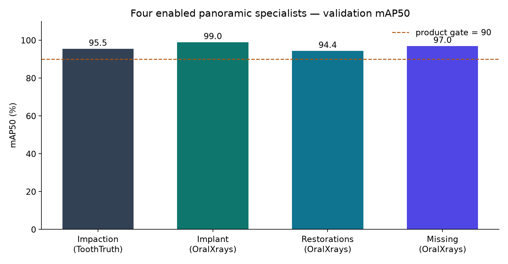

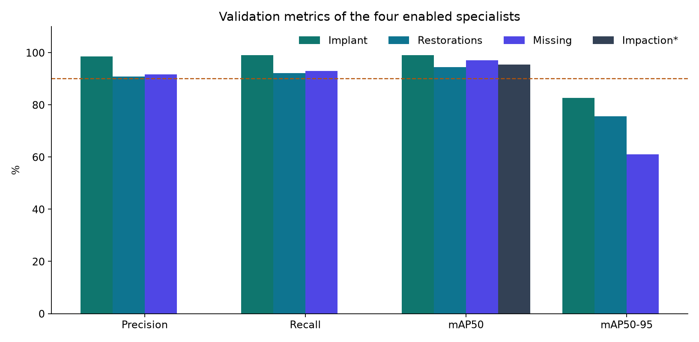

\*الانطمار: القياس المعتمد في المنتج هو mAP50 للفئة Impacted tooth من تشغيل ToothTruth (train-4). Precision/Recall/mAP50–95 التفصيلية لذلك التشغيل غير محفوظة في هذا المجلد بنفس ملفات OralXrays.

---

## 3. الفئة 1 — الانطمار (Impaction)

**القاعدة:** vzrad2 / ToothTruth (بانوراما)  
**ما اعتُمد فقط من هذه القاعدة:** السن المنطمر.

| البند | القيمة |
|---|---|
| الفئة الظاهرة | Impacted tooth |
| القياس المعتمد | mAP50 = **95.5٪** (في الواجهة يُعرض 96٪) |
| الوزن | `models/xray/specialists/impaction.pt` |
| الحالة | **مفعّل** |
| عتبة الثقة | 0.40 |
| تدريب OralXrays لهذه الفئة | **قرار نهائي: لن يُشغَّل** (الوزن الحالي 95.5٪ كافٍ) |

ما لم يُعتمد من القاعدة الأولى لأنه تحت 90 أو غير موثوق:

| الفئة القديمة | آخر قياس قديم | القرار |
|---|---|---|
| الأسنان المفقودة | mAP50 ≈ 67٪ | أُعيد تدريبها على OralXrays → 97٪ (أدناه) |
| الترميمات | mAP50 ≈ 55٪ | أُعيد تدريبها على OralXrays → 94.4٪ |
| الآفة الذروية | mAP50 ≈ 8٪ | ما زالت محجوبة |
| فقدان العظم | mAP50 ≈ 21٪ | ما زال محجوبًا |
| التشريح (قناة فكية، أسنان كاملة…) | — | لا يُعرض كتشخيص أبدًا |

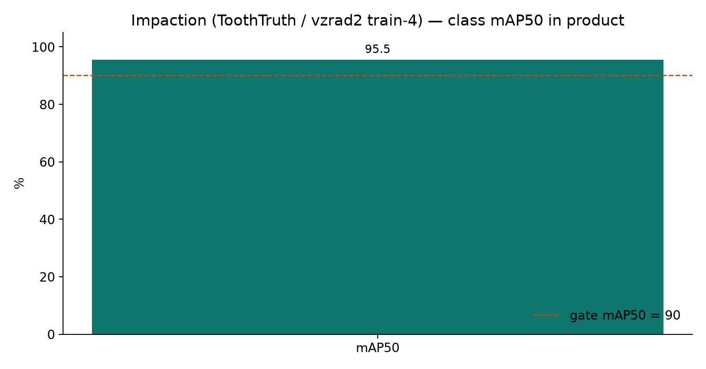

**عيّنة بانوراما فيها ضرس مطمور (من عيّنات المنتج):**

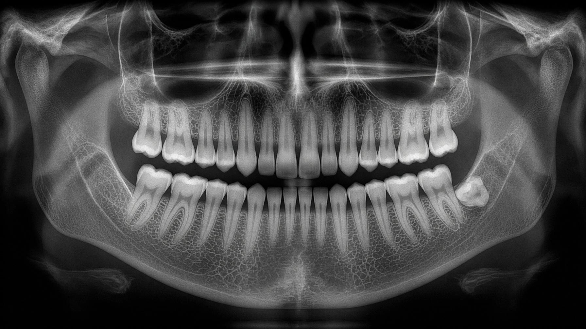

---

## 4. الفئة 2 — الزرعة (Implant) — OralXrays

| البند | القيمة |
|---|---|
| الأصناف | 1: `implant` |
| صور التدريب | 1087 |
| صور التحقق | 970 |
| النموذج | YOLO11n ، 640 ، حتى 80 عصرًا |
| ماذا حدث | إيقاف مبكر عند العصر **76** |
| أفضل mAP50–95 | العصر **61** |
| الوزن | `models/xray/specialists/implant.pt` |
| الحالة | **مفعّل** |
| عتبة الثقة | 0.50 |

**نتائج التحقق:**

| المقياس | آخر عصر (76) | أفضل قيمة |
|---|---|---|
| Precision | 98.6٪ | 99.1٪ |
| Recall | 99.0٪ | 99.5٪ |
| **mAP50** | **99.0٪** | **99.2٪** |
| **mAP50–95** | **82.6٪** | **82.8٪** |

التجربة على الموقع: بانوراما تحقق فيها زرعات → الواجهة أظهرت صناديق **Implant** (21 كشفًا في اللقطة أدناه).

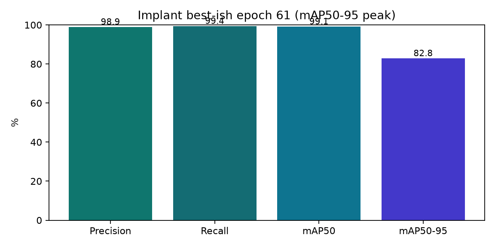

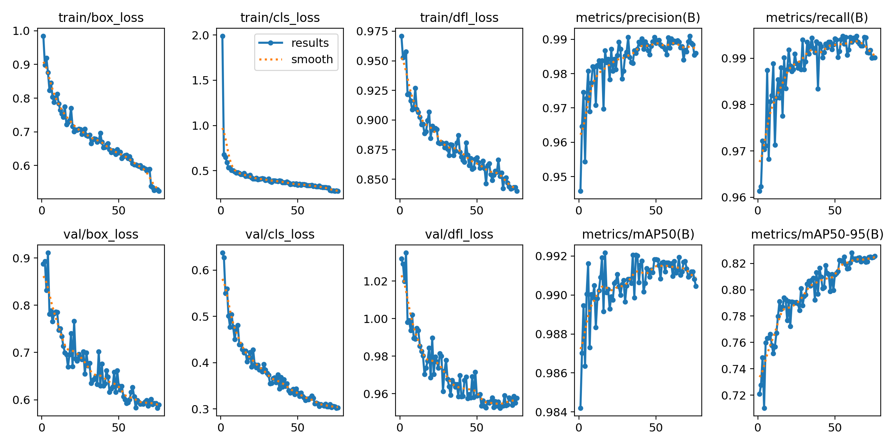

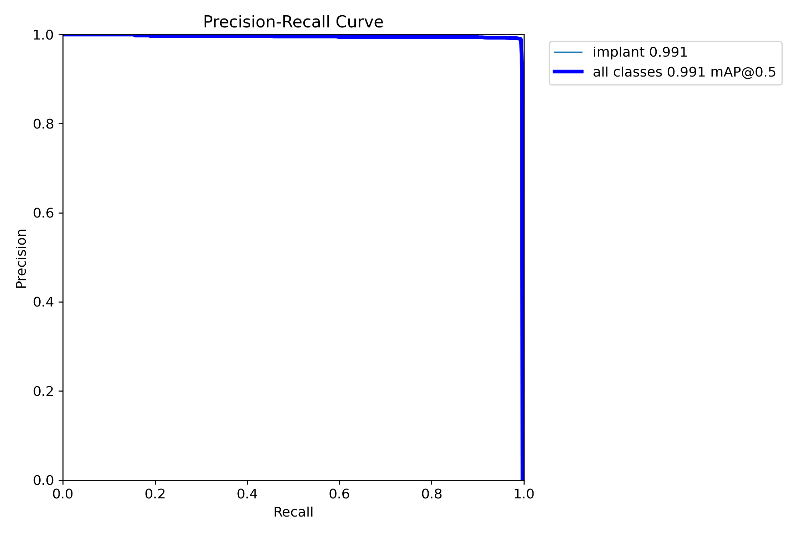

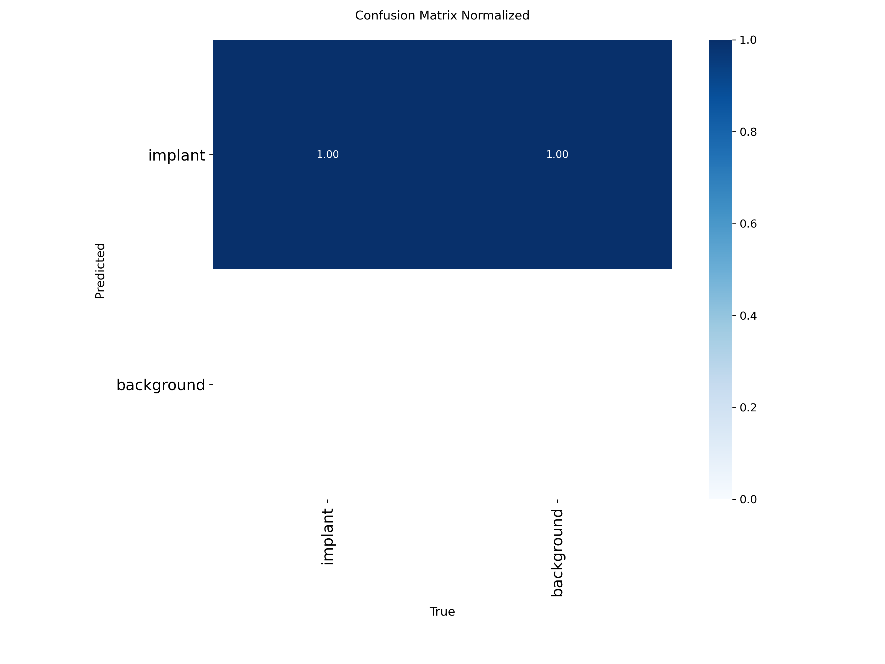

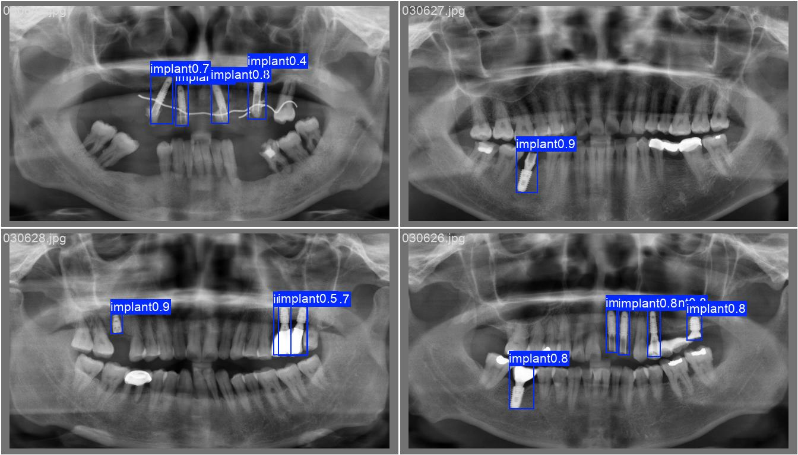

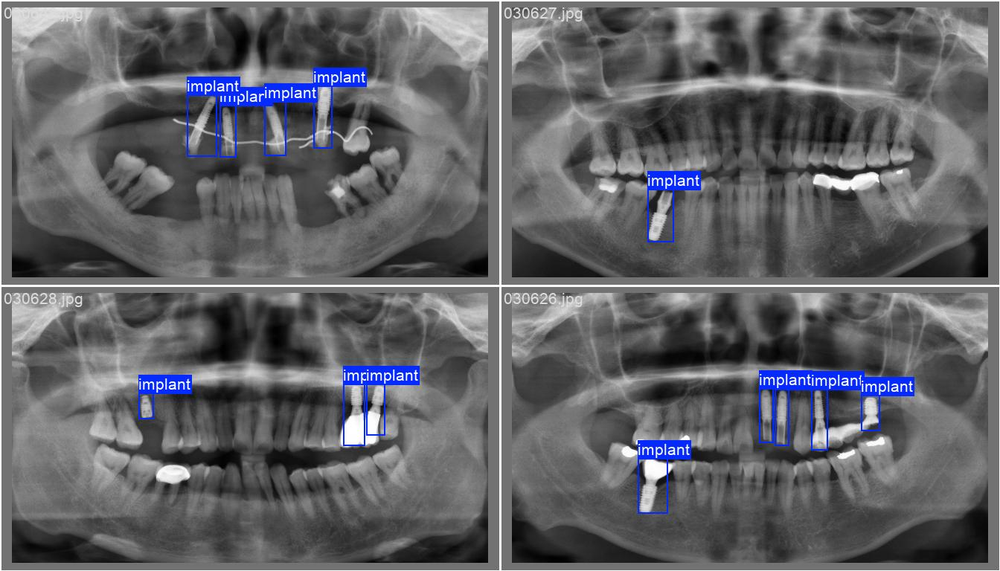

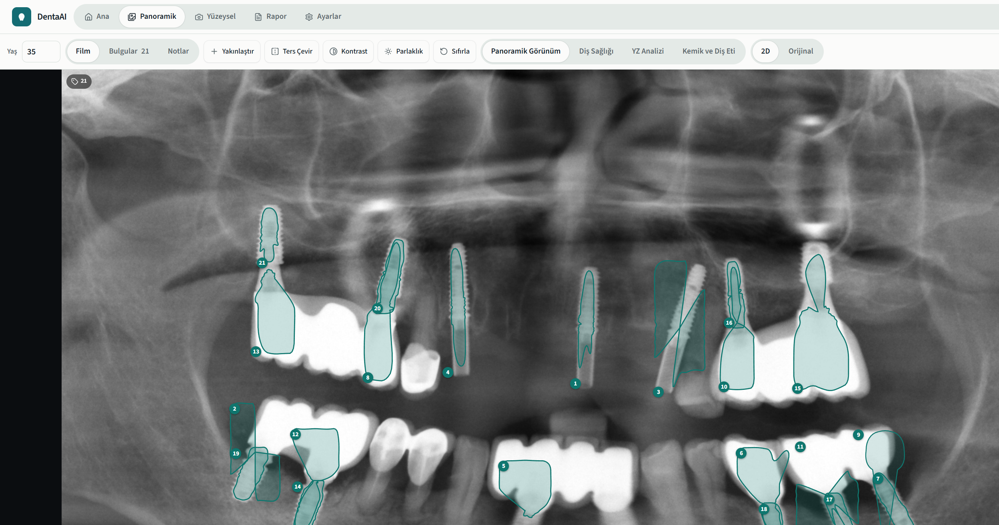

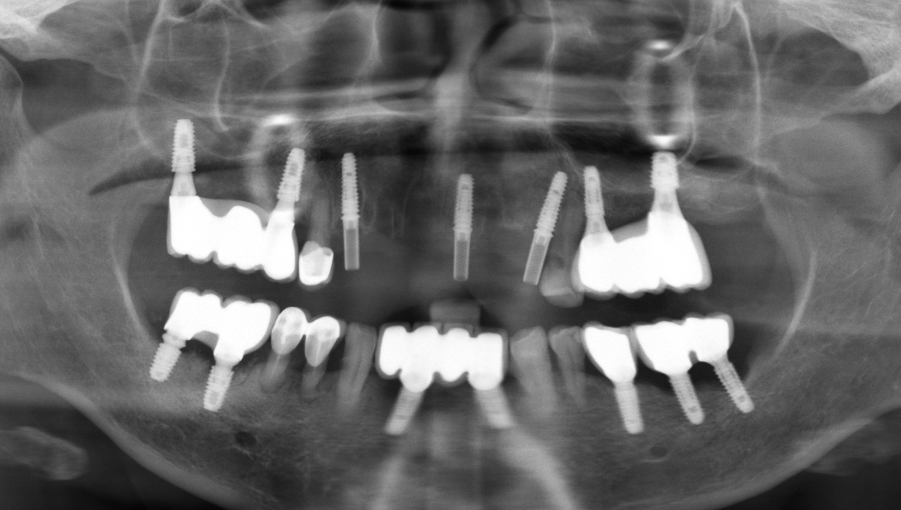

---

## 5. الفئة 3 — الترميمات (Restorations) — OralXrays

| البند | القيمة |
|---|---|
| الأصناف | 4: جسر `bridge`، تاج `crown`، حشوة `filling`، حشوة قناة `rootCanal` |
| صور التدريب | 6322 |
| صور التحقق | 1887 (7701 حالة) |
| النموذج | YOLO11n ، 640 |
| ماذا حدث | أُوقف بعد العصر **61** بعد ثبات الدقة |
| أفضل وزن | العصر **57** (`best.pt`) |
| الوزن المنسوخ | `models/xray/specialists/restorations.pt` |
| الحالة | **مفعّل** |
| عتبة الثقة | 0.50 |

**نتائج أفضل وزن (العصر 57):**

| المقياس | القيمة |
|---|---|
| Precision | **90.9٪** |
| Recall | **92.2٪** |
| **mAP50** | **94.4٪** |
| **mAP50–95** | **75.6٪** |

مسار التحسن: العصر 1 = 88.0٪ mAP50 → العصر 4 تجاوز 90 → العصر 57 ثبت عند 94.4٪. آخر العصور بقيت حول 94.4–94.5٪؛ لذلك الإيقاف كان صحيحًا.

عدد التسميات في التدريب (من مخطط labels): جسر 4320، تاج 3800، حشوة 9427، قناة 6094. الحشوة هي الأكثر؛ لذلك الصنف الأسهل نسبيًا، والجسر/التاج أصعب لأنهما متشابهان شعاعيًا.

الترميمات أصعب من الزرعة (4 أصناف متشابهة)، و94.4٪ فوق شرط 90 وتُعد نجاحًا.

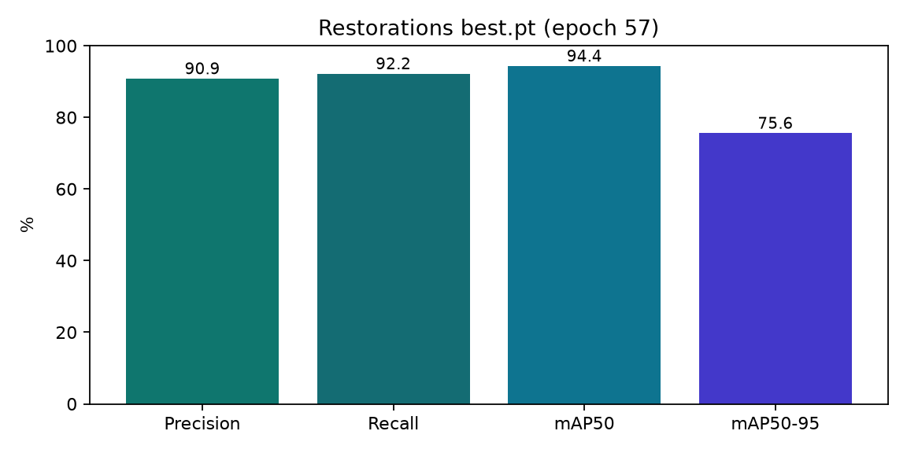

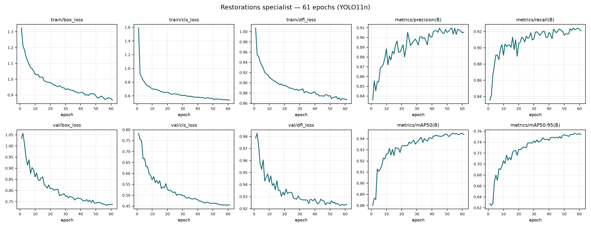

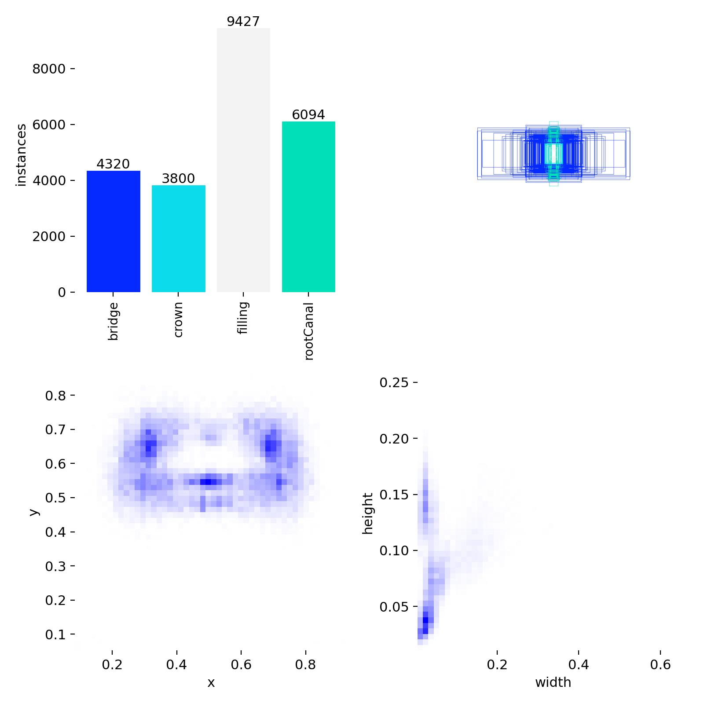

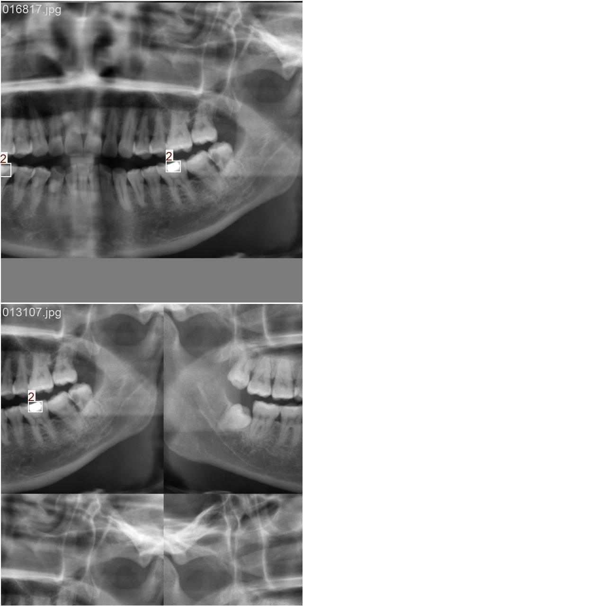

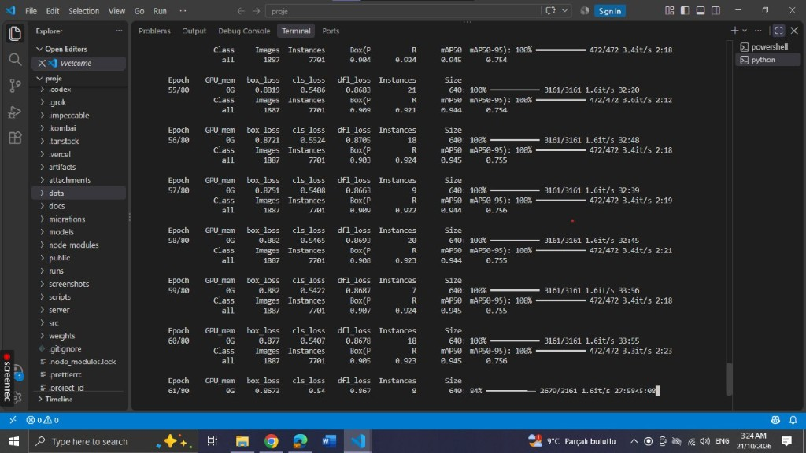

---

## 6. الفئة 4 — الأسنان المفقودة (Missing) — OralXrays

| البند | القيمة |
|---|---|
| الأصناف | 1: `missingTooth` |
| صور التدريب | 2164 |
| صور التحقق | 466 (660 حالة) |
| النموذج | YOLO11n ، 640 ، CPU |
| المدة | **8.079 ساعة** |
| ماذا حدث | إيقاف مبكر: أفضل نتيجة العصر **27**، توقف عند **42 / 80** (patience = 15) |
| الوزن | `models/xray/specialists/missing.pt` (نُسخ من best.pt) |
| الحالة | **مفعّل** |
| عتبة الثقة | 0.50 |

**نتائج التحقق لـ best.pt (بعد نهاية التدريب):**

| المقياس | القيمة |
|---|---|
| Precision | **91.7٪** |
| Recall | **93.0٪** |
| **mAP50** | **97.0٪** |
| **mAP50–95** | **61.0٪** |

آخر ثلاثة عصور قبل الإيقاف:

| العصر | Precision | Recall | mAP50 | mAP50–95 |
|---|---|---|---|---|
| 40 | 87.4٪ | 94.7٪ | 95.9٪ | 59.2٪ |
| 41 | 89.4٪ | 94.5٪ | 97.2٪ | 60.2٪ |
| 42 | 88.2٪ | 90.7٪ | 97.0٪ | 60.8٪ |

mAP50 فوق 90 بوضوح، لذلك فُعّلت الفئة. mAP50–95 = 61٪ أضعف من الزرعة (82.8٪) والترميمات (75.6٪): النموذج يجد الفراغ جيدًا (mAP50) لكن الصندوق أقل إحكامًا. بوابة المنتج تعتمد **mAP50** وليس mAP50–95.

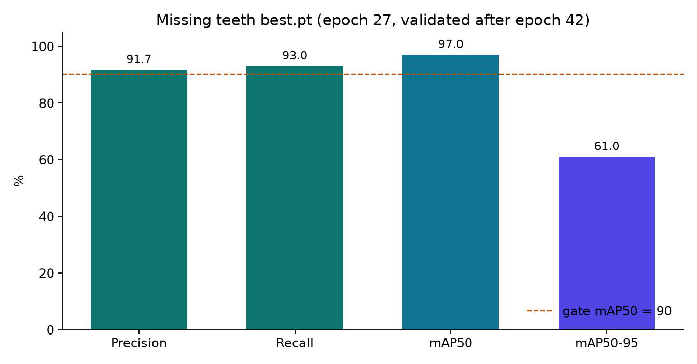

**لقطة انتهاء التدريب (21 تشرين الأول 2026، 23:21) ونسخ الوزن إلى `missing.pt`:**

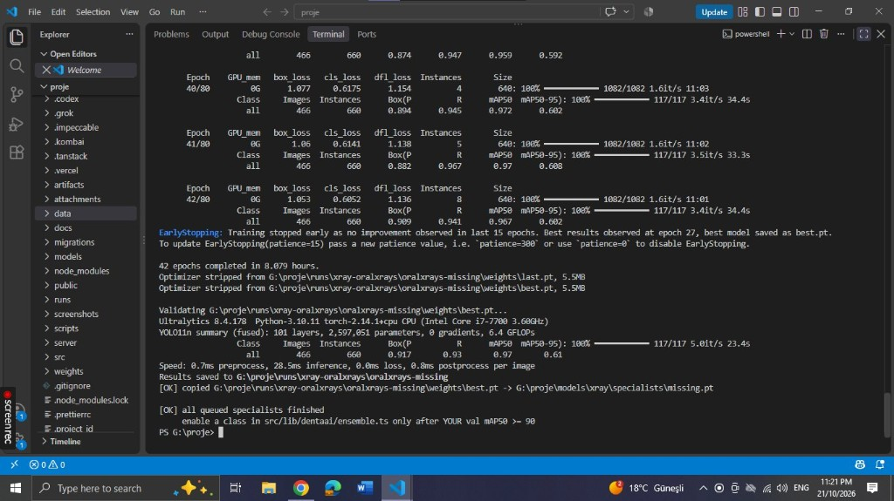

---

## 7. مقارنة الأربع المكتملة

| | الانطمار | الزرعة | الترميمات | المفقودة |
|---|---|---|---|---|
| القاعدة | ToothTruth / vzrad2 | OralXrays | OralXrays | OralXrays |
| عدد الأصناف | 1 | 1 | 4 | 1 |
| حجم التدريب | تشغيل train-4 السابق | 1087 | 6322 | 2164 |
| العصور | تشغيل سابق | 76 (إيقاف مبكر) | 61 (إيقاف بعد الثبات) | 42 (إيقاف مبكر، أفضلها 27) |
| المدة على هذا الجهاز | سابقة | ~يوم | أوقف بعد الثبات | 8.08 ساعة |
| **mAP50** | **95.5٪** | **99.0٪** | **94.4٪** | **97.0٪** |
| mAP50–95 | غير محفوظ هنا | 82.6–82.8٪ | 75.6٪ | 61.0٪ |
| هل تجاوزت 90؟ | نعم | نعم | نعم | نعم |
| في الموقع؟ | نعم | نعم | نعم | نعم |
| ملف الوزن | `impaction.pt` | `implant.pt` | `restorations.pt` | `missing.pt` |

أعلى mAP50: الزرعة 99٪. أقربها لعتبة 90: الترميمات 94.4٪ (أربع أصناف). أسرع OralXrays اكتمالاً: الأسنان المفقودة (8 ساعات).

---

## 8. ما لا يظهر في قسم الأشعة

| المتخصص | السبب | القرار |
|---|---|---|
| التسوس البانورامي (Decay) | قياس منشور ضعيف؛ لم يُدرَّب عندنا فوق 90 | محجوب |
| الآفة الذروية | آخر قياس قديم ≈ 8٪ | محجوب |
| فقدان العظم | آخر قياس قديم ≈ 21٪ | محجوب |
| انطمار OralXrays | قرار نهائي: لا يُدرَّب | الانطمار الحالي 95.5٪ كافٍ؛ تجنّب تكرار نفس الفئة من قاعدتين |
| التشريح | قناة فكية / أسنان كاملة ليست تشخيصًا | لا تُعرض أبدًا |

---

## 9. الخلاصة

1. **أربع فئات شغّالة** في قسم الأشعة: انطمار 95.5٪، زرعة 99.0٪، ترميمات 94.4٪، أسنان مفقودة 97.0٪.  
2. **أول قاعدة** أعطت المنتج الانطمار فقط.  
3. **ثاني قاعدة** أعطت الزرعة ثم الترميمات ثم الأسنان المفقودة، كل واحدة بقياس تحقق حقيقي فوق 90.  
4. لم تُخلط القاعدتان في رأس واحد.  
5. التسوس والآفة الذروية وفقدان العظم ما زالت خارج الواجهة.  
6. **قرار نهائي:** لن يُدرَّب انطمار OralXrays. المنتج مكتمل لهذه الأربع. قاعدة الأشعة المستخدمة: ToothTruth للانطمار فقط، وOralXrays للزرعة والترميمات والمفقودة. لا خلط في رأس واحد.

---

# Türkçe bölüm

## 1. Benimsenen yöntem

DentaAI panoramik bölümü tek bir “her şeyi gören” model değildir. Her klinik görev için ayrı bir **uzman ağırlık** dosyası vardır. Tanı ancak bizim doğrulama ölçümümüz şu eşiği geçerse gösterilir:

**mAP50 ≥ %90**

Eşiğin altı gizlenir. İki veri kümesi tek kafa içinde karıştırılmadı.

Yeni uzmanlar: **YOLO11n**, görüntü **640**, en fazla **80 epoch**, 15 epoch sabitse erken durdurma. Donanım: CPU (Intel Core i7-7700). Yaş kuralı: panoramik analiz **16 yaş ve üzeri**.

---

## 2. Bugün açık olan dört sınıf

| # | Tanı | Kaynak | Sınıf | mAP50 | Precision | Recall | mAP50–95 | Eşik | Durum |
|---|---|---|---|---|---|---|---|---|---|
| 1 | Gömülü diş | 1. küme: ToothTruth / vzrad2 | 1 | **%95,5** | — | — | — | 0,40 | **Açık** |
| 2 | İmplant | 2. küme: OralXrays-9 | 1 | **%99,0** | %98,6 | %99,0 | %82,6 | 0,50 | **Açık** |
| 3 | Dolgu / kuron / köprü / kanal | 2. küme: OralXrays-9 | 4 | **%94,4** | %90,9 | %92,2 | %75,6 | 0,50 | **Açık** |
| 4 | Eksik diş | 2. küme: OralXrays-9 | 1 | **%97,0** | %91,7 | %93,0 | %61,0 | 0,50 | **Açık** |


\*Gömülü diş: üründeki ölçüm ToothTruth train-4 içindeki Impacted tooth sınıfının mAP50 değeridir.

---

## 3. Sınıf 1 — Gömülü diş (Impaction)

| Madde | Değer |
|---|---|
| Gösterilen sınıf | Impacted tooth |
| Ölçüm | mAP50 = **%95,5** (arayüzde 96) |
| Ağırlık | `models/xray/specialists/impaction.pt` |
| Durum | **Açık** |
| Güven tabanı | 0,40 |
| OralXrays eğitimi | **Nihai karar: çalıştırılmayacak** (mevcut %95,5 yeterli) |

Birinci kümeden alınmayanlar: eski eksik diş %67 (OralXrays’te %97 oldu), eski restorasyon %55 (OralXrays’te %94,4 oldu), periapikal %8 ve kemik kaybı %21 hâlâ gizli. Anatomi asla tanı değildir.


---

## 4. Sınıf 2 — İmplant (OralXrays)

| Madde | Değer |
|---|---|
| Sınıf | 1: `implant` |
| Eğitim / doğrulama | 1087 / 970 |
| Model | YOLO11n, 640, en fazla 80 epoch |
| Sonuç | Erken durdurma, epoch **76** |
| En iyi mAP50–95 | Epoch **61** |
| Ağırlık | `models/xray/specialists/implant.pt` |
| Durum | **Açık** |
| Güven tabanı | 0,50 |

| Metrik | Son epoch (76) | En iyi |
|---|---|---|
| Precision | %98,6 | %99,1 |
| Recall | %99,0 | %99,5 |
| **mAP50** | **%99,0** | **%99,2** |
| **mAP50–95** | **%82,6** | **%82,8** |

Arayüz: çok implanlı doğrulama panoramiğinde Implant kutuları (aşağıdaki karede 21 tespit).


---

## 5. Sınıf 3 — Restorasyonlar (OralXrays)

| Madde | Değer |
|---|---|
| Sınıflar | 4: `bridge`, `crown`, `filling`, `rootCanal` |
| Eğitim / doğrulama | 6322 / 1887 (7701 örnek) |
| Model | YOLO11n, 640 |
| Sonuç | Epoch **61** sonrası durduruldu |
| En iyi ağırlık | Epoch **57** |
| Kopya | `models/xray/specialists/restorations.pt` |
| Durum | **Açık** |
| Güven tabanı | 0,50 |

**En iyi ağırlık (epoch 57):**

| Metrik | Değer |
|---|---|
| Precision | **%90,9** |
| Recall | **%92,2** |
| **mAP50** | **%94,4** |
| **mAP50–95** | **%75,6** |

Epoch 1’de mAP50 %88 idi; epoch 4’te %90’ı geçti; epoch 57’de %94,4’te durdu. Etiket sayıları: köprü 4320, kuron 3800, dolgu 9427, kanal 6094.


---

## 6. Sınıf 4 — Eksik diş (OralXrays)

| Madde | Değer |
|---|---|
| Sınıf | 1: `missingTooth` |
| Eğitim / doğrulama | 2164 / 466 (660 örnek) |
| Model | YOLO11n, 640, CPU |
| Süre | **8,079 saat** |
| Sonuç | Erken durdurma: en iyi epoch **27**, durduğu epoch **42 / 80** |
| Ağırlık | `models/xray/specialists/missing.pt` |
| Durum | **Açık** |
| Güven tabanı | 0,50 |

**best.pt doğrulaması:**

| Metrik | Değer |
|---|---|
| Precision | **%91,7** |
| Recall | **%93,0** |
| **mAP50** | **%97,0** |
| **mAP50–95** | **%61,0** |

Son üç epoch: 40 → mAP50 %95,9; 41 → %97,2; 42 → %97,0. Ürün kapısı mAP50’dir; %97 eşiği geçer. mAP50–95 (%61) implant ve restorasyondan düşüktür: boşluk bulunur, kutu daha gevşek kalır.


---

## 7. Dört sınıfın karşılaştırması

| | Gömülü | İmplant | Restorasyon | Eksik diş |
|---|---|---|---|---|
| Küme | ToothTruth | OralXrays | OralXrays | OralXrays |
| Sınıf sayısı | 1 | 1 | 4 | 1 |
| Eğitim | train-4 | 1087 | 6322 | 2164 |
| Epoch | önceki | 76 | 61 | 42 (en iyi 27) |
| **mAP50** | **%95,5** | **%99,0** | **%94,4** | **%97,0** |
| mAP50–95 | — | %82,6–82,8 | %75,6 | %61,0 |
| Eşik (≥90) | Geçti | Geçti | Geçti | Geçti |
| Arayüz | Açık | Açık | Açık | Açık |

En yüksek mAP50 implanttır (%99). Eşiğe en yakın restorasyondur (%94,4; dört sınıf). OralXrays içinde en hızlı biten eksik diştir (8 saat).

---

## 8. Panoramikte hâlâ gizli olanlar

| Uzman | Neden | Karar |
|---|---|---|
| Panoramik çürük | Yayımlanmış skor zayıf; bizde 90+ yok | Gizli |
| Periapikal lezyon | Eski ölçüm ≈ %8 | Gizli |
| Kemik kaybı | Eski ölçüm ≈ %21 | Gizli |
| OralXrays gömülü | Nihai karar: eğitilmeyecek | Mevcut %95,5 yeterli; aynı sınıf iki kümeden tekrarlanmaz |
| Anatomi | Tanı değil | Asla gösterilmez |

---

## 9. Sonuç

1. Panoramikte **dört sınıf açık**: gömülü %95,5, implant %99,0, restorasyon %94,4, eksik diş %97,0.  
2. Birinci küme ürüne yalnızca gömülü dişi verdi.  
3. İkinci küme implant, restorasyon ve eksik dişi verdi; her biri kendi doğrulamasında %90’ı aştı.  
4. Kümeler tek kafada karıştırılmadı.  
5. Çürük, periapikal ve kemik kaybı hâlâ gizli.  
6. **Nihai karar:** OralXrays gömülü eğitilmeyecek. Bu dört sınıf tamam. Panoramikte ToothTruth yalnızca gömülü diş için, OralXrays implant / restorasyon / eksik diş için. Tek kafada karışım yok.

---

## Dosya yolları

```
models/xray/specialists/impaction.pt       ← 1. küme, sınıf 1
models/xray/specialists/implant.pt         ← 2. küme, sınıf 2
models/xray/specialists/restorations.pt    ← 2. küme, sınıf 3
models/xray/specialists/missing.pt         ← 2. küme, sınıf 4

runs/xray-oralxrays/oralxrays-implant/
runs/xray-oralxrays/oralxrays-restorations/
runs/xray-oralxrays/oralxrays-missing/

docs/report-xray-section/                  ← bu rapor + tüm şekiller
```

**Bu klasördeki görseller:**

| Dosya | Ne |
|---|---|
| `four-enabled-map50.png` | Dört sınıfın mAP50 karşılaştırması |
| `four-enabled-all-metrics.png` | Precision / Recall / mAP50 / mAP50–95 |
| `impaction-00-best-metrics.png` | Gömülü diş mAP50 |
| `sample-panoramic.jpg` | Örnek panoramik (gömülü 20) |
| `implant-00-best-metrics.png` | İmplant özet metrikleri |
| `implant-01-training-curves.png` | İmplant eğitim/doğrulama eğrileri |
| `implant-02-pr-curve.png` | İmplant Precision–Recall |
| `implant-03-confusion.png` | İmplant karışıklık matrisi |
| `implant-04-val-pred.jpg` | İmplant doğrulama tahminleri |
| `implant-05-val-labels.jpg` | Aynı partinin etiketleri |
| `implant-06-ui-live.png` | DentaAI arayüzünde implant |
| `sample-implant.jpg` | Örnek implant filmi |
| `restorations-best-metrics.png` | Restorasyon özet metrikleri (epoch 57) |
| `restorations-training-curves.png` | 61 epoch eğrileri |
| `restorations-03-labels.jpg` | Restorasyon etiket dağılımı |
| `restorations-04-train-batch.jpg` | Eğitim partisi |
| `restorations-terminal-epochs.png` | Epoch 55–61 terminal kaydı |
| `missing-00-best-metrics.png` | Eksik diş özet metrikleri |
| `missing-terminal-complete.png` | Eğitim bitişi ve missing.pt kopyası |
